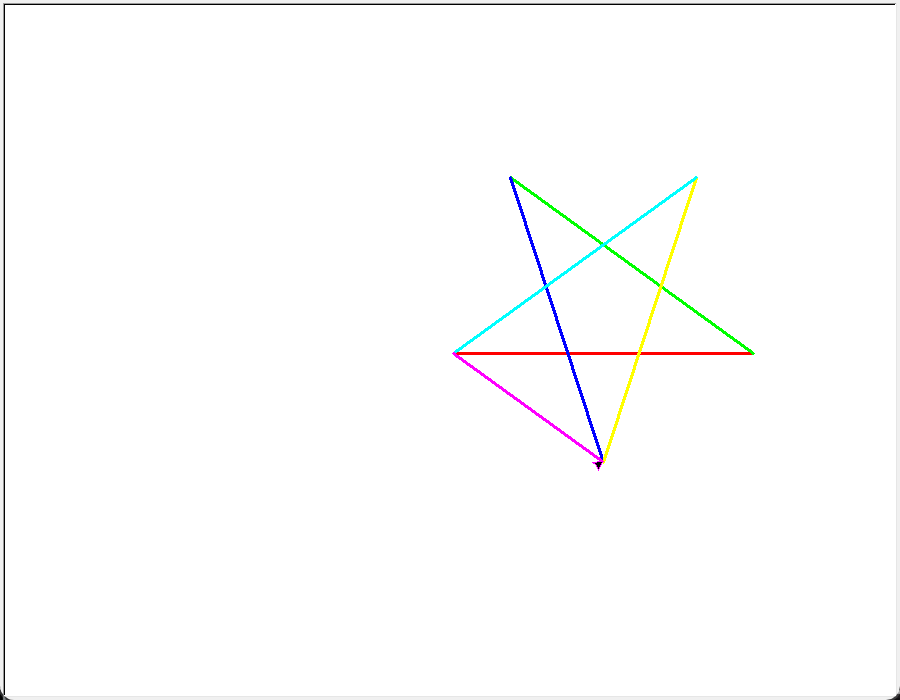

# 自动轨迹绘制

经典 turtle 实验：程序读取数据文件，按指令**自动绘制**彩色轨迹，不需要人工控制海龟。

## 数据格式

`trace_data.txt` 每行一条指令，共 6 个字段：

```
距离, 转向标志, 角度, R, G, B
```

- **距离**：海龟前进的像素数
- **转向标志**：`0` 左转，`1` 右转
- **角度**：转向角度
- **R, G, B**：画笔颜色（0~1 浮点数）

示例：

```
300,0,144,1,0,0    # 前进300，左转144°，红色画笔
300,0,144,0,1,0    # 前进300，左转144°，绿色画笔
...
```

## 运行

```bash
python main.py
```

运行后自动在控制台打印读取的指令数，并把 turtle 画布窗口截图保存为
`screenshots/trace_result.png`（窗口置顶 + DPI 感知 + 渲染等待，保证截图完整）。

## 成果预览



## 目录结构

```
auto-trace-drawing/
├── main.py                    # 主程序（读取数据 + 自动绘制 + 自动截图）
├── trace_data.txt             # 轨迹数据文件
└── screenshots/
    └── trace_result.png       # 运行结果截图
```
